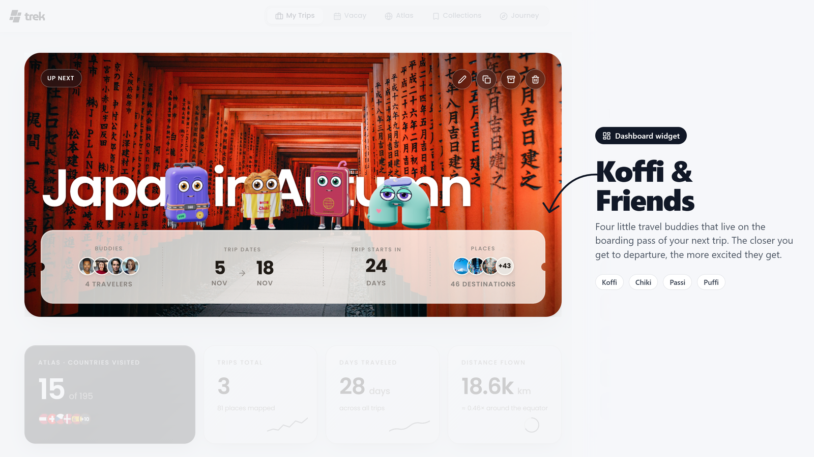

# Koffi & Friends

> A dashboard widget: four little 3D travel buddies that walk along the boarding pass of your next trip.

## What it does

It is a **dashboard widget**. Once the plugin is active, the troupe walks
along the boarding pass at the bottom of the big "Up next" trip card. There is nothing to
open and no extra page: if you have an upcoming trip, they are there.

Pick who walks there in **Settings → Plugins → Koffi & Friends**: one of them,
or two for a duo.

### The troupe

| | |
|---|---|
| **Koffi** | a cabin trolley on four spinner wheels. His party trick is a wheelie. |
| **Chiki** | a crispy konbini chicken in a striped paper sleeve. Somebody keeps taking bites. |
| **Passi** | a passport with a silk ribbon. Collects stamps, and flies with his covers. |
| **Puffi** | a fleece neck pillow, forever five minutes from a nap. |

They walk, sit, nap, stretch, wave and hop, and each has a signature move.
Two of them together meet up now and then: a high five, a chase, Puffi riding
on Koffi for a nap.

They also react to your actual trip. The closer the departure, the more
excited they get; while the trip is running they put on sunglasses.

## Screenshots

## Permissions

| Permission | Why this plugin needs it |
|---|---|
| `db:read:trips` | To read the current trip's start/end dates so the troupe knows how excited to be. The read is membership-checked by TREK, so they only ever see a trip you already have access to. |
| `db:own` | To remember which mascots you picked, in the plugin's own private store. Nothing else is kept, and one user's pick is never visible to another. |

No network access.

## Setup

None. Enable plugins on your instance (`TREK_PLUGINS_ENABLED=true`), install
and activate Koffi & Friends, and the troupe appears on the boarding pass of
your dashboard. They respect `prefers-reduced-motion` (a still pose, no
walking).

The figures are drawn with WebGL. A browser without it gets the flat 2D
characters instead.

## Building

The figures are procedural Three.js models (no model files), in
`client/mascots3d.js`, on top of the state machine in `client/engine.js` and
the characters' behaviour in `client/characters/`. Three.js r149 is vendored in
`client/vendor/`.

Both frames are single files: `node build.mjs` inlines every script into
`client/index.html` (the widget) and `client/settings.html` (the picker), and
`node build.mjs --check` fails when they are out of date.

## License

MIT, see the TREK repository. Three.js is MIT as well (header kept in
`client/vendor/three.min.js`).
